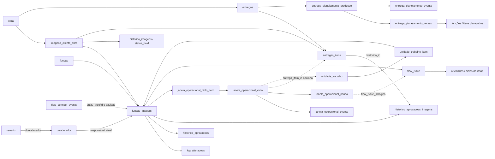

# Diagnóstico técnico — Performance do Colaborador

Data: **05/11/2026**. Escopo: investigação, sem implementação de funcionalidades.

**É viável construir as duas timelines com os mecanismos existentes, desde que a interface exponha a cobertura e as lacunas do histórico.** O Flow já possui ciclos, eventos, pausas, planejamento versionado e um barramento de eventos. A recomendação é começar por uma projeção de leitura dessas fontes. Não há justificativa, neste diagnóstico, para duplicar todo o histórico em outra tabela.

Não é possível apresentar uma jornada retrospectiva universalmente completa, identificar o autor de toda movimentação ou medir horas efetivamente trabalhadas com os registros atuais.

## 1. Escopo, fontes e grau de confirmação

Foram examinados o código da árvore de trabalho, migrations, helpers, produtores de dados, restrições e triggers do backup completo `Backup/backup_completo_2026-11-05_02-00-01.sql`. Os números deste relatório são **do snapshot desse backup**, não do banco ativo. O arquivo foi lido sem restauração ou execução de SQL. As contagens foram extraídas dos INSERTs e a quantidade de campos das linhas analisadas foi conferida contra suas definições.

A conexão pelo PHP CLI não pôde ser estabelecida: as variáveis `DB_HOST`, `DB_USERNAME`, `DB_PASSWORD` e `DB_DATABASE` não estavam disponíveis nesse processo. Nenhuma configuração ou credencial foi modificada. Portanto, implantação atual de triggers, configuração do Event Scheduler, fusos das conexões e diferenças entre backup e banco ativo continuam sem confirmação por introspecção.

O navegador interno acessou **https://improov/ImproovWeb/**, realizou o login de desenvolvimento e navegou pela interface para **Gestão → Atividade** e **Gestão → Flow Track → Tarefas**. A autenticação e a navegação funcionaram. Na consulta, a página inicial exibiu indisponibilidade de alguns indicadores e Atividade exibiu warnings de inclusão de `css/modalSessao.php`; posteriormente carregou informações de atividade. Esses problemas preexistentes foram apenas registrados, conforme o escopo de investigação. Não houve acionamento de atribuição, mudança de status, exclusão ou entrega. Login e navegação podem produzir os registros normais de acesso da aplicação.

A segunda URL oficial não foi necessária para contornar falha de acesso, pois a primeira permitiu autenticação. Não se concluiu indisponibilidade do ambiente. Não houve validação responsiva de uma nova interface, pois nenhuma foi criada ou alterada.

A árvore de trabalho já continha alterações de terceiros, inclusive em `Entregas/registrar_entrega.php`, `PreAlteracao/conclusao_helpers.php`, `helpers/janela_operacional_helper.php`, além de `Entregas/registro_item_helper.php` não rastreado. O diagnóstico considera esse conteúdo atual, sem atribuí-lo à versão publicada. **Somente este relatório e seu inventário de campos foram criados.**

O [inventário complementar de campos](diagnostico-performance-colaborador-campos.md) documenta, para **72 tabelas**, todos os campos, tipos, defaults, chaves, índices, FKs e regras de exclusão declaradas no snapshot. Ele integra este relatório; não é uma migration proposta.

### Evidências quantitativas do snapshot

| Evidência                                          |                                                                                  Resultado | Implicação                                                                                              |
| -------------------------------------------------- | -----------------------------------------------------------------------------------------: | ------------------------------------------------------------------------------------------------------- |
| Tarefas em `funcao_imagem`                         |                                                                                      9.585 | Estado atual do snapshot, não total de tarefas que já existiram                                         |
| Linhas em `log_alteracoes`                         |                                                                                     39.373 | Eventos disponíveis desde 08/08/2024 entre as datas válidas; início do intervalo não comprova cobertura |
| Tarefas atuais sem qualquer log                    |                                                               1.958, aproximadamente 20,4% | Não presumir criação, início ou conclusão recuperáveis pelo log                                         |
| Logs com data zero                                 |                                                                                        124 | Não podem ser ordenados como eventos com instante conhecido                                             |
| Logs com status anterior igual ao novo             |                                                                                        252 | Não contar automaticamente como transição                                                               |
| Logs com `colaborador_id` nulo                     |                                                                                        491 | Não preencher com o responsável atual sem marcar inferência                                             |
| Linhas em `historico_aprovacoes`                   |                                                                                     24.251 | Incluem imagem e animação; há uma data zero                                                             |
| Aprovações idênticas em todos os campos, exceto ID |                                                         6.539 linhas excedentes nos grupos | Evidência concreta de duplicação; não somar linhas brutas como movimentações                            |
| Aprovações com `responsavel = 1`                   |                                                                                     19.290 | Incluem registros automáticos de triggers; não comprovam autoria humana                                 |
| Ciclos / tarefas distintas vinculadas a ciclos     |                                                                                  670 / 523 | A cobertura canônica é apenas um subconjunto das tarefas                                                |
| Qualidade dos ciclos                               | 622 `CANONICO`; 45 `LEGADO_PARCIAL`; 1 `REGULARIZADO_FALLBACK`; 2 `REGULARIZADO_HISTORICO` | A classificação ajuda a selecionar a coorte, mas não garante completude de todos os campos              |
| Ciclos sem `inicio_em`                             |                                                                                         92 | Pode ser espera legítima por início, ciclo encerrado sem início ou limitação histórica                  |
| Ciclos sem `entrega_item_id`                       |                                                                                 644 de 670 | Apenas 26 têm vínculo explícito com item/rodada de entrega                                              |
| Eventos de janela / pausas                         |                                                                                 2.518 / 19 | Histórico estruturado disponível desde setembro/2026 no snapshot                                        |
| Histórico de prazo / histórico de previsão         |                                                                                5.290 / 805 | Reutilizáveis; não equivalem a execução                                                                 |
| Registros mensais                                  |                                                                                      4.597 | Consolidação contábil, sem preservar cada repetição do evento                                           |
| Eventos em `flow_connect_events`                   |                                                                                     13.860 | Misturam acontecimentos operacionais, alertas, falhas e resumos                                         |

Nenhum desses números é uma avaliação individual de desempenho. A ausência de evento não comprova ausência de trabalho.

## 2. Mapa das entidades e relacionamentos

As setas representam vínculos de consulta; nem todos são FKs. `usuario.idcolaborador`, por exemplo, é uma associação lógica no snapshot. As FKs efetivamente declaradas estão no inventário.

### Identidades que a futura página precisa preservar

- **Tarefa:** `funcao_imagem.idfuncao_imagem`. Há unicidade por `(imagem_id, funcao_id)`, de modo que a mesma linha pode ser reutilizada em novas rodadas.
- **Rodada/entrega:** `entregas_itens.id`, quando a associação está comprovada; etapas da imagem e datas próximas não substituem esse vínculo.
- **Tentativa de execução:** `janela_operacional_ciclo.id`, com número, origem e ligação ao ciclo anterior.
- **Unidade operacional:** agrupamento de tarefas em `unidade_trabalho`, além de agrupamentos legados usados pelo WIP.
- **Responsável:** pessoa que respondia pela tarefa naquele segmento temporal.
- **Ator:** usuário/colaborador que executou a movimentação; pode ser diferente do responsável, externo, sistema ou desconhecido.

## 3. Fontes de dados, atualização e histórico disponível

Os campos completos estão no inventário. A tabela abaixo explica a semântica e o comportamento dos escritores encontrados.

| Fonte                                                                | Campos e vínculos centrais                                                                                                                                                      | Atualização e histórico                                                                                                                                                                                                                                                              |
| -------------------------------------------------------------------- | ------------------------------------------------------------------------------------------------------------------------------------------------------------------------------- | ------------------------------------------------------------------------------------------------------------------------------------------------------------------------------------------------------------------------------------------------------------------------------------ |
| `funcao_imagem`                                                      | ID, imagem, função, colaborador, prazo DATE, status, observação, valores/pagamento, flags de upload/render e `file_uploaded_at`                                                 | Retrato atual. Não tem `created_at`, `started_at`, `completed_at` ou data de atribuição. INSERT recebe `Não iniciado` por trigger quando status está vazio. UPSERTs e UPDATEs reutilizam a linha                                                                                     |
| `log_alteracoes`                                                     | ID, tarefa, arquivo opcional, status anterior/novo, `data` TIMESTAMP, colaborador                                                                                               | Trigger de INSERT registra estado inicial; trigger de UPDATE registra status diferente usando `OLD.status != NEW.status`. Grava **NEW.colaborador_id**, não usuário da sessão. Atribuição sem mudança de status não gera evento nesse trigger. Comparação não é null-safe            |
| `historico_aprovacoes`                                               | ID, tarefa de imagem ou animação, arquivo opcional, status anterior/novo, `data_aprovacao` DATETIME, colaborador, `responsavel`, observações                                    | Revisão interna, envio para aprovação e direção. Nos escritores de revisão, colaborador é executor/responsável da tarefa e `responsavel` é revisor. Nos triggers de envio, `responsavel=1` fixo. Há sobreposição com log, eventos e inserções explícitas                             |
| `historico_aprovacoes_imagens`                                       | Tarefa de imagem/animação, mídia, índice de envio, `data_envio`, caminho/nome e atributos de mídia                                                                              | Evidência de versão enviada, sem ator explícito. Substituir ângulo pode sobrescrever mídia e `data_envio`; exclusão pode remover a versão. Não é, isoladamente, decisão de aprovação                                                                                                 |
| `imagens_cliente_obra`                                               | Imagem, obra, cliente, imagem principal, tipo/subtipo, etapa `status_id`, `substatus_id`, recebimento, início e prazo DATE                                                      | Datas de contexto da imagem, não início/conclusão de cada tarefa. `dias_trabalhados` não é apontamento individual de horas. Mudanças de função podem atualizar substatus da imagem                                                                                                   |
| `historico_imagens`                                                  | Imagem, etapa, substatus, `data_movimento`                                                                                                                                      | Trigger registra estado inicial e mudança de etapa/substatus. Sem ator e sem responsável snapshot. Na mudança de etapa, o trigger força substatus 2. Comparações com NULL podem omitir transições                                                                                    |
| `status_hold`                                                        | Justificativa, imagem, obra, `data_hold`, prazo                                                                                                                                 | Registra inclusão de justificativa. Não tem saída, autor ou tarefa/ciclo. Várias justificativas não significam vários episódios. Registros podem ser editados ou excluídos                                                                                                           |
| `cronograma_funcao_imagem`, `cronograma_entrega`                     | **Não localizadas** no snapshot e nos fluxos PHP/SQL pesquisados                                                                                                                | Não há campos ou histórico confirmados. Confirmar no banco ativo antes de tratá-las como fonte existente                                                                                                                                                                             |
| `gantt_prazos`, `etapa_colaborador`                                  | Obra/imagem/tipo/etapa, dias, início/fim planejados; colaborador ligado ao Gantt                                                                                                | Substitutos legados de cronograma. Datas e responsável são sobrescritos; não têm timestamps de alteração nem trilha de versões. Troca no Gantt não equivale necessariamente a transferência da tarefa operacional                                                                    |
| `entregas`                                                           | Obra, etapa, tipo, previsão/conclusão/recebimento DATE, situação, HOLD, motivo, criação/atualização, arquivamento                                                               | Retrato da entrega. `updated_at` muda por qualquer edição. HOLD é sobrescrito; retirada apaga o motivo. Arquivar preserva linhas; excluir pode remover filhos ou falhar por FKs                                                                                                      |
| `entregas_itens`                                                     | Entrega, imagem, previsão/entrega TIMESTAMP, situação, histórico visual, criação/atualização                                                                                    | Não identifica executor. Na árvore atual, o helper de registro preserva a **primeira** `data_entregue` via COALESCE, mesmo quando o status é reaberto para nova versão. Não interpretar como última entrega                                                                          |
| `entregas_p00_versoes`, `entregas_pendencias`                        | Versões P00 ligadas a imagem/tarefa/mídia e datas; pendências com abertura/resolução e resolvedor                                                                               | Contextualizam versões e pendências da entrega. A versão tem campos mutáveis e não registra autor de toda alteração. Entrega ao cliente não é conclusão da função                                                                                                                    |
| `janela_operacional_ciclo` e `_ciclo_item`                           | Tarefas, unidade, ciclo anterior, responsável original/atual, origem/qualidade, início/fim, situação, snapshots de prazo/previsão/perfil/motivo/plano, item de entrega opcional | Núcleo da execução. Ajuste pode abrir ciclo `AGUARDANDO_INICIO` com início nulo. Início efetivo ativa o ciclo. Envio à aprovação encerra execução; **não significa tarefa Finalizada**. Transferência cria sucessor ligado ao anterior                                               |
| `janela_operacional_evento`                                          | Ciclo, tipo, status/estado/previsão anteriores/novos, responsáveis anteriores/novos, atores usuário/colaborador, detalhes JSON e criação                                        | Gravador central existente. Registra início, ajuste recebido, envio, encerramento, previsão, HOLD, transferência e reabertura por tipos/origens/detalhes. Histórico por adição no código consultado, sem garantia de imutabilidade no banco                                          |
| `janela_operacional_pausa`                                           | Ciclo, issue opcional, início/fim, dias úteis suspensos, origem e atores de abertura/encerramento                                                                               | Melhor fonte de intervalos HOLD da execução coberta. Uma pausa ativa por ciclo. Fechar/transferir ciclo também pode fechar pausa; correlacionar sucessores                                                                                                                           |
| `unidade_trabalho`, `_item`, `_evento`                               | Imagem, tipo, responsável, estado, membros, atores, eventos/detalhes e timestamps                                                                                               | Agrupa tarefas que consomem uma unidade de WIP. Não multiplicar duração pelo número de membros. Estado e composição atuais não são um snapshot completo de toda a história                                                                                                           |
| `funcao_imagem_prazo_historico`                                      | Prazo anterior/novo, status, `alterado_em`, atores usuário/colaborador, origem/motivo                                                                                           | Helper central grava UPDATE e auditoria na transação do chamador quando o prazo muda. Não garante captura de escritores que o contornem. No snapshot, não possui FK para tarefa                                                                                                      |
| `funcao_imagem_previsao_conclusao`, `_historico`                     | Previsão atual e histórico com anterior/nova, justificativa, prazo necessário, versão do plano, atores e criação                                                                | Previsão atual é mutável. Histórico replica parte da janela por compatibilidade: não contar ambas as fontes como dois eventos                                                                                                                                                        |
| `funcao_imagem_registro_mensal`                                      | Tarefa, colaborador, imagem/função, status, observação, `data_evento`, ano/mês e criação                                                                                        | Consolidação por tarefa/mês/status/observação com INSERT IGNORE; não conserva todas as repetições nem toda troca de pessoa no mesmo mês. Não tem FK para tarefa no snapshot. O script de backfill inclui datas contábeis aproximadas derivadas de pagamento                          |
| `entrega_planejamento_*`                                             | Cabeçalho, baseline e versões confirmadas; funções/itens, responsáveis **planejados**, datas, snapshots, eventos, fila e projeções                                              | Preserva replanejamentos confirmados por versão. Rascunho e projeção atuais são mutáveis. Evento de alocação central tem ator e movimentos antes/depois no JSON. Planejamento não comprova execução                                                                                  |
| `flow_issue`, `_atividade`, `_ciclo`, `_operacional`, `_dependencia` | Tarefa/origem, responsável da issue, criador/resolvedor/confirmador, estados, SLA, eventos e intervalos                                                                         | Explica bloqueios, dependências e tratativas. Autor, responsável da issue e responsável da tarefa são pessoas distintas. Resolver issue não libera automaticamente a tarefa; confirmação e retomada são etapas diferentes. Comentários são editáveis e têm tombstone de exclusão     |
| `flow_connect_events`                                                | UUID, tipo/versão, módulo, entidade, ator, `occurred_at`/`received_at`, correlação/causa, chave de idempotência, payload/metadados e controle de processamento                  | Barramento existente. Já registra revisões, direção, bloqueios, render e falhas de arquivo. Publicação depende de integração/flags e pode falhar sem impedir a ação principal. `PROCESSED/PENDING/DEAD` é estado da fila, não da tarefa; não filtrar acontecimentos só por PROCESSED |
| `imagem_decisoes`, `_angulos`; `review_batch`, `_items`              | Decisão externa por item/mídia/usuário externo; lotes/rodadas e `entered_rvw_at`/`left_rvw_at`                                                                                  | Decisão externa usa UPSERT e substitui decisão, autor e data anteriores. Batch ajuda a medir review externo, que não é aprovação interna. Entrada pode ser reconstruída a partir da entrega                                                                                          |
| `funcao_animacao`, `log_funcao_animacao`, `animacao`                 | Função/animação/responsável/status/prazo, criação e histórico de status; aprovação também em `historico_aprovacoes`                                                             | Necessários se a jornada incluir animação. Trigger registra transição e responsável, sem resolver autoria universal. Não misturar IDs de animação e imagem                                                                                                                           |
| `tarefas`                                                            | Responsável, título/descrição, prioridade, prazo/status, origem/referência e criação                                                                                            | Tarefas manuais entram no WIP. O fluxo examinado atualiza a linha sem histórico de cada transição. Não tem a mesma cobertura de ciclos das tarefas de imagem                                                                                                                         |
| Arquivos, render, pré-alteração, funções planejadas e acessos        | Ver fontes contextuais abaixo e inventário                                                                                                                                      | Explicam contexto; não substituir evidência operacional específica por proximidade de datas                                                                                                                                                                                          |

### Fontes contextuais adicionais

- **`arquivo_log`, `arquivos`:** tarefa/obra/imagem, colaborador, datas e situação dos envios. O worker atualiza estados, podendo separar pedido de envio de publicação efetiva. `file_uploaded_at` guarda apenas um instante atual. Falha ou espera de upload não é automaticamente tempo humano de execução.
- **`render_alta`, `log_render`, `render_tentativas`, `render_tentativa_eventos`, `render_conclusoes_manuais`:** fila, execução de máquina, tentativas/falhas e conclusão manual. Relevantes para explicar resultados e a suspensão do consumo de WIP durante render. Tempo de render não é hora trabalhada do colaborador.
- **`pre_alt_lote`, `_historico`, `_itens`, `_liberacoes`, `_liberacao_itens`:** rodada, recebimento/validação/liberação e ligação à entrega. A liberação pode limpar o responsável e recolocar uma `funcao_imagem` existente em `Não iniciado`, mantendo seu ID.
- **`imagem_funcao_planejada`, `_historico`:** escopo previsto, inclusão/cancelamento e associação à execução; autor/payload e criação no histórico. O trigger pode marcar planejamento como `INICIADO` quando cria a função, ainda que o status operacional seja `Não iniciado`; não usar isso como início de execução.
- **`funcao_imagem_angulo_ciencia`:** escolhido por, destinatário, escolha/visualização e mídia. Visualizar uma referência não equivale a iniciar tarefa.
- **`acompanhamento_email`:** contexto da obra e vínculos com entrega/arquivo; eventos manuais são editáveis e há produtor legado com autor fixo. Datas DATE devem aparecer como “sem horário”. Não é fonte universal de autoria.
- **`logs_usuarios`, `logs_usuarios_historico`:** login, presença e telas visitadas; não demonstram atuação em uma tarefa, tempo produtivo ou execução fora do navegador.
- **Dimensões `colaborador`, `usuario`, `funcao`, `obra`, `status_imagem`, `substatus_imagem`:** nomes, vínculo de identidade e classificação atuais. Alterar cadastro ou desativar pessoa não deve reatribuir o passado. Filtrar somente ativos esconderia parte da história.

## 4. Rastreabilidade dos dez acontecimentos solicitados

| Acontecimento            | O que pode ser recuperado hoje                                                                                                                                    | Cobertura e autoria                                                                                                                                                                                              |
| ------------------------ | ----------------------------------------------------------------------------------------------------------------------------------------------------------------- | ---------------------------------------------------------------------------------------------------------------------------------------------------------------------------------------------------------------- |
| 1. Atribuição inicial    | Log de INSERT pode indicar responsável e instante da criação; alocação central registra movimentos; ciclo fotografa responsável ao iniciar                        | **Parcial.** Criação não é necessariamente atribuição. Radar e alguns formulários alteram apenas `colaborador_id`, sem evento de atribuição. Início do ciclo não informa desde quando a pessoa já estava alocada |
| 2. Início de execução    | `EXECUCAO_INICIADA`, `inicio_em`, origem e atores; fallback por entrada em `Em andamento` no log                                                                  | **Disponível na coorte canônica com início válido; parcial no conjunto.** Distinguir primeiro início, ajuste, transferência e reabertura                                                                         |
| 3. Mudança de status     | Log anterior/novo, aprovações, eventos de janela e histórico de imagem                                                                                            | **Parcial para o conjunto.** Há datas inválidas, tarefas sem log, comparações envolvendo NULL e duplicação. Histórico da imagem não substitui histórico da função                                                |
| 4. Envio para aprovação  | Evento canônico e encerramento por envio; logs e aprovações legadas; mídia como evidência complementar                                                            | Instante normalmente recuperável onde existe transição. Triggers duplicados e `responsavel=1` não identificam quem enviou. Mídia pode ter sido substituída                                                       |
| 5. Retorno para ajuste   | Revisão para `Ajuste`, evento `AJUSTE_RECEBIDO`, novo ciclo pendente e eventos de review no Flow Connect                                                          | Boa evidência nas rotas integradas; parcial em legado. `Aprovado com ajustes` tem semântica própria e não deve virar automaticamente mais um retorno                                                             |
| 6. Entrada/saída de HOLD | Pausas/eventos de janela; logs da tarefa; atividades e ciclos de Flow Block; histórico de substatus da imagem                                                     | **Parcial globalmente.** HOLD da entrega não tem intervalos; justificativa não registra saída. Resolver issue, confirmar e continuar tarefa são instantes diferentes                                             |
| 7. Finalização           | Transição para `Finalizado` no log e evidências de produtores/worker; registro mensal como apoio                                                                  | **Parcial globalmente.** Pode ser automática após aprovação/upload. Não usar encerramento do ciclo como finalização, nem prazo/pagamento como data de conclusão                                                  |
| 8. Reabertura            | Ciclo com origem `REABERTURA` e ligação anterior; transição de terminal para estado aberto; nova liberação da pré-alteração                                       | Recuperável onde há eventos. Reutilização do ID exige distinguir nova rodada de retrabalho da rodada anterior. Nome do evento isolado não cobre todas as reaberturas                                             |
| 9. Transferência         | Transferência canônica fecha ciclo anterior, grava responsáveis antes/depois e abre sucessor; alocação central contém movimentos no JSON                          | **Parcial.** UPDATE direto em tarefa não dispara log de status. Gantt altera planejamento sem histórico; responsabilidade planejada não comprova transferência operacional                                       |
| 10. Autor de cada ação   | Eventos de janela com `ator_usuario_id` e `ator_colaborador_id`; atividades Flow Block; histórico de prazo/previsão; revisões e Flow Connect em rotas específicas | **Indisponível de forma universal.** Parte é conhecida; log legado só informa responsável. Não inferir login exato a partir de colaborador; não atribuir ação de sistema a uma pessoa                            |

### Regras de interpretação da autoria

1. `log_alteracoes.colaborador_id` é, no trigger inspecionado, o **responsável após o UPDATE**. Inserções manuais, inclusive retomada Flow Block e rotina automática, podem usar outra semântica ou NULL. A coluna não deve virar um campo genérico “quem fez”.
2. Em `FlowReview/revisarTarefa.php`, `colaborador_id` é obtido do contexto da tarefa e `responsavel` representa o revisor. O revisor pode vir da requisição, com fallback para a sessão. Isso é evidência do papel registrado, não prova uniforme do usuário autenticado executor.
3. Os triggers `after_update_funcao_imagem` e `aprovacao_imagem_update` do backup executam a mesma gravação de entrada em aprovação com `responsavel=1`. Há ainda trigger de INSERT e escritores explícitos. Preservar a origem e marcar o autor desses registros como não comprovado.
4. `imagem_decisoes.usuario_id` pertence a **`usuario_externo`**. Não juntar a `usuario.idusuario` ou `colaborador.idcolaborador` pelo número.
5. `flow_connect_events.actor_id` precisa ser interpretado pelo contrato do produtor. Em eventos de review, o factory usa o revisor/colaborador; não é uma FK universal de usuário interno.

## 5. Integridade em replanejamentos, transferências e exclusões

| Operação                             | O que permanece                                                                                       | Risco ou perda                                                                                                                                                                        |
| ------------------------------------ | ----------------------------------------------------------------------------------------------------- | ------------------------------------------------------------------------------------------------------------------------------------------------------------------------------------- |
| Replanejamento confirmado            | Baseline, versões, etapas/itens e eventos do plano; snapshots já gravados em ciclos                   | Gantt e campos atuais são sobrescritos. Prazo atual não prova qual era o compromisso no início. Exclusão da raiz/entrega pode apagar filhos ou ser bloqueada por outras FKs           |
| Transferência canônica em execução   | Ciclo de origem, saída com antes/depois, sucessor e motivo/atores                                     | Não há cobertura de todos os escritores. Sem ciclo ativo, helper pode retornar `SEM_CICLO_ATIVO`; atribuição antes do início continua com lacunas                                     |
| Transferência por UPDATE direto      | Logs antigos mantêm o responsável que registraram na época; snapshots existentes continuam úteis      | A troca em si pode não ter timestamp nem autor. Fazer JOIN apenas com a tarefa atual reatribui indevidamente todo o passado                                                           |
| Nova rodada de alteração             | Históricos de status e ciclos anteriores podem permanecer; novas versões do plano ajudam              | Reutiliza tarefa e pode limpar responsável. A maioria dos ciclos do snapshot não possui `entrega_item_id`; não ligar retrospectivamente à última entrega por conveniência             |
| Exclusão de tarefa/imagem            | Históricos sem FK podem sobreviver como referências órfãs; alguns vínculos restritivos impedem DELETE | FKs de `log_alteracoes`, aprovações, mídias e previsões têm CASCADE em relações relevantes. Excluir imagem também afeta suas funções e histórico de imagem. Não há retenção universal |
| Exclusão de tarefa já ligada a ciclo | `janela_operacional_ciclo_item` usa RESTRICT para tarefa                                              | Pode impedir a exclusão. Isso não é garantia geral: excluir ciclo remove eventos/pausas/itens por CASCADE, e outras rotas/estruturas têm regras distintas                             |
| Exclusão de entrega/item             | Arquivamento preserva linhas                                                                          | DELETE físico pode apagar itens, decisões e lotes ou falhar por FKs de ciclos/planejamento. Não há tombstone comum de tarefa/entrega                                                  |
| Edição/exclusão de mídia e decisão   | Pode haver referências complementares                                                                 | Substituição de ângulo muda `data_envio`; exclusão apaga mídia. Decisão externa por UPSERT perde a sequência anterior                                                                 |

**Resposta à questão de integridade:** replanejar e transferir pelos fluxos canônicos preserva partes importantes da história; não é possível garantir integridade completa em todas as rotas, nem após toda exclusão. Backups não devem funcionar como fonte online da página. Podem apoiar recuperação supervisionada, sempre com proveniência, sem fabricar eventos exatos.

## 6. Indicadores e fórmulas

### Convenções de cálculo

- Período mensal: **`[M0, M1)`**, primeiro instante do mês até o primeiro instante do seguinte, no fuso de apresentação definido. Para mês em andamento, corte `T = min(agora, M1)`.
- Unidade de contagem: tarefa `q`; quando comprovada, separar rodada `r`. Tentativas/ciclos `c` são outra medida. Publicar separadamente “tarefas”, “rodadas” e “tentativas”, sem somá-las como se fossem equivalentes.
- Para cada evento, conservar responsável vigente `R(q,t)`. Quando não houver evidência, o segmento fica **sem responsável histórico conhecido**; o responsável atual serve somente ao retrato atual.
- Para um intervalo `[a,b)`, sua duração no período é `D(a,b) = max(0, min(b,T) - max(a,M0))`. Intervalo aberto termina provisoriamente em T. Limites desconhecidos não viram zero.
- Intervalos HOLD sobrepostos devem ser unidos antes da soma. Aprovação interna, direção, review externo, render e execução são categorias distintas. Pausa da issue pode não coincidir com HOLD da tarefa.
- “Conclusão” padrão neste diagnóstico é transição para **`Finalizado`**. Envio para aprovação, aprovação e entrega ao cliente têm indicadores próprios. Se a regra de uma função considerar outra transição como entrega humana, nomear explicitamente essa métrica.

| Indicador                               | Classificação                                                  | Fórmula e fonte                                                                                                                                                                                             | Limitação principal                                                                                                                                                                                   |
| --------------------------------------- | -------------------------------------------------------------- | ----------------------------------------------------------------------------------------------------------------------------------------------------------------------------------------------------------- | ----------------------------------------------------------------------------------------------------------------------------------------------------------------------------------------------------- |
| Tarefas iniciadas no mês                | **Parcial**                                                    | `COUNT DISTINCT(q,r)` cujo primeiro início válido da rodada está em `[M0,T)` e responsável no início é a pessoa; ciclo/log                                                                                  | Ciclos de transferência, ajuste e reabertura não são automaticamente novas tarefas. Primeiro início observado pode não ser primeiro início real                                                       |
| Tarefas concluídas no mês               | **Parcial**                                                    | `COUNT DISTINCT(q,r)` com conclusão válida no período e responsável comprovado naquele instante; log, contexto temporal e ciclo                                                                             | Contar separadamente eventos de conclusão e tarefas únicas. Reabertura posterior não apaga conclusão passada; apresentar também saldo reaberto. Sem rodada conhecida, contar tarefa e sinalizar       |
| Tarefas herdadas de períodos anteriores | **Parcial**                                                    | Tarefas sob responsabilidade da pessoa imediatamente antes de M0 e ainda não encerradas nesse corte                                                                                                         | Exige estado e atribuição no limite do mês, inclusive eventos anteriores ao filtro. Não basta prazo anterior ou status atual                                                                          |
| Tarefas que permanecem abertas          | **Disponível para estado atual; parcial para corte histórico** | No retrato atual, contar tarefas atribuídas cujo estado não seja terminal nem excluído do escopo; separar não iniciadas, execução, ajuste, aprovação, direção e HOLD. No passado, reconstruir `estado(q,T)` | Aprovação pode continuar aberta; cancelada/Não se aplica ficam fora do backlog produtivo. Semântica deve ser por domínio                                                                              |
| Tempo médio de conclusão por função     | **Parcial**                                                    | Por rodada concluída com início válido, `AVG(conclusao - primeiro_inicio)`; publicar também mediana e tamanho/cobertura da amostra                                                                          | É tempo decorrido do fluxo. Atravessa aprovação, espera e HOLD; transferências exigem segmentos. Não usar só último ciclo nem comparar mistura de funções/complexidades                               |
| Tempo em andamento                      | **Parcial**                                                    | Soma de `D(entrada_Em_andamento, próxima_saída)` por tarefa/rodada; ou duração de execução de ciclo válido, descontada união das pausas, com nome próprio                                                   | Estado e ciclo podem divergir em legado. Duração de ciclo termina no envio, transferência ou outro encerramento, não necessariamente na conclusão                                                     |
| Tempo aguardando aprovação              | **Parcial**                                                    | Soma de `D(entrada_Em_aprovacao, saída_Em_aprovacao)` após deduplicar envios; logs, aprovações e evento canônico                                                                                            | Não somar duas linhas dos triggers. `Aguardando Direção` deve ser faixa separada ou soma explicitamente identificada. Reabertura exige novo intervalo                                                 |
| Tempo em ajuste                         | **Parcial**                                                    | Fila do ajuste: `AJUSTE_RECEBIDO → EXECUCAO_INICIADA`; execução do ajuste: `inicio_em → envio/saída`, menos pausas; soma por ciclo AJUSTE                                                                   | Status Ajuste mede espera até início, pois a execução muda para Em andamento. Não usar apenas permanência literal em Ajuste para todo retrabalho. Fallback de início no envio não revela duração real |
| Tempo em HOLD                           | **Parcial**                                                    | União das interseções de pausas da janela com período e segmento do responsável; fallback separado por transições explícitas de status                                                                      | Entrega só tem flag atual; justificativas não bastam. Issue resolvida não prova fim do HOLD; pausa da issue e pausa da tarefa não são intercambiáveis                                                 |
| Quantidade de retornos para ajustes     | **Parcial**                                                    | Contar transições semânticas para Ajuste após revisão, por decisão/ciclo, consolidando `AJUSTE_RECEBIDO`, histórico, log e evento Flow Connect                                                              | Não contar criação do ciclo e ajuste recebido como dois retornos; distinguir decisão por ângulo, interna e do cliente. Decisões externas sobrescritas são irrecuperáveis sem outra evidência          |
| Cumprimento de prazos                   | **Parcial**                                                    | `100 × conclusões_no_prazo / conclusões_com_prazo_e_datas_válidos`; comparar marco definido com baseline e, separadamente, compromisso vigente no evento                                                    | Usar snapshot/histórico/versão, nunca só prazo atual. Data DATE não tem hora. Prazo da função, janela operacional e entrega cliente têm significados diferentes; publicar cobertura do denominador    |
| Volume de tarefas simultâneas           | **Disponível para WIP atual; parcial historicamente**          | Reutilizar helper de WIP. No histórico, `W(t)=número de unidades operacionais ativas da pessoa`; pico `max W(t)` e média temporal `integral W(t)dt/(T-M0)`                                                  | Agrupar tarefas conjuntas e pares legados; render pode deixar de consumir WIP. Não somar durações de tarefas para chamar de jornada diária. Precisaria reconstruir composição/estados históricos      |
| Distribuição por obra e função          | **Disponível no retrato atual; parcial historicamente**        | `COUNT DISTINCT(q)` agrupado por obra/função/responsável atual; histórico usa segmentos ou eventos/rodadas com responsabilidade comprovada                                                                  | Divulgar se mede estoque, entradas ou conclusões. Não repetir tarefa por JOIN com múltiplos logs/itens/ciclos                                                                                         |

**Indisponíveis como medidas exatas do universo histórico:** horas efetivamente trabalhadas, data de toda atribuição, autoria de todas as movimentações, todos os episódios HOLD de entrega e sequência completa de decisões externas sobrescritas. Nenhuma das treze famílias de indicadores precisa ser descartada integralmente; várias só são defensáveis com recorte e cobertura explícitos.

### Cuidados específicos com as fórmulas

1. No ciclo canônico, `encerrado_em - inicio_em - união_das_pausas` é **tempo decorrido de execução registrado**. Não subtrai todas as esperas reais, trabalho externo, noites ou outras tarefas e não é esforço humano.
2. Dias úteis seguem calendário e regra dos helpers. Não converter duração em horas para dias úteis por divisão por 24. `dias_uteis_suspensos` usa a regra de suspensão da janela, diferente da duração de calendário do HOLD.
3. Ao reutilizar `flow_janela_dias_consumidos()`, passar a data de corte/encerramento: seu padrão usa hoje e não fecha automaticamente a conta em `encerrado_em`.
4. No fallback de ajuste enviado sem início explícito, o fluxo inicia e encerra no mesmo instante, marcado `REGULARIZADO_FALLBACK`. Excluir essa duração de médias de execução ou apresentá-la como início desconhecido, nunca “ajuste instantâneo”.
5. Médias de conclusão incluem apenas observações encerradas válidas. Mostrar também quantidade/idade das abertas, tamanho da amostra e excluídas; caso contrário, tarefas lentas ainda abertas desaparecem da comparação.
6. Para transferência, a duração da tarefa pode atravessar várias pessoas. Apresentar duração total e segmentos de responsabilidade. Não creditar todo o intervalo à última pessoa nem repartir proporcionalmente sem evidência.
7. O helper `flow_execucao_status_trabalho_efetivo()` usa estados amplos como proxy de tentativa operacional, inclusive aprovação/conclusão. O nome não o torna uma fonte de horas efetivas nem de início preciso.
8. Registro mensal e fechamento financeiro possuem regras específicas de competência, pagamento e deduplicação. O backfill pode atribuir data ao último dia de competência anterior a partir de pagamento: útil para fechamento, inadequado como horário operacional real.

## 7. Viabilidade das duas timelines

### Timeline do colaborador

É possível apresentar uma sequência cronológica de **acontecimentos observados**: início de execução, envio, revisão/retorno, bloqueio, retomada, prazo/previsão, transferência conhecida, reabertura e conclusão registrada. O filtro de pessoa precisa oferecer dois papéis distintos: **tarefas sob sua responsabilidade** e **ações praticadas por ela**. Uma aprovação realizada por um gestor em tarefa de outra pessoa pertence ao segundo papel, não à produção dele.

Para responsabilidades, buscar ciclos/snapshots e movimentos anteriores ao período, reconstruir segmentos e recortar os eventos. Para ações, usar somente atores explicitamente conhecidos. Exibir separadamente eventos de sistema e autoria desconhecida. Sem vínculo histórico, um evento pode aparecer na timeline da tarefa sem poder ser atribuído à timeline de uma pessoa.

O período não pode limitar a consulta inicial a eventos internos ao mês: o estado de abertura, o início de um HOLD ou a atribuição vigente podem vir de antes. Intervalos que continuam após o mês terminam visualmente no corte e ficam identificados como ainda abertos.

### Timeline da tarefa

É possível unir o histórico sobrevivente pelo ID da tarefa, mostrando ciclos, responsáveis conhecidos, revisão, mídias, bloqueios, prazos e entregas relacionadas. Dividir por rodada quando `entrega_item_id` ou outro vínculo explícito permitir. Manter um agrupamento “rodada não identificada” para o legado, em vez de ligar tudo à etapa atual.

Eventos da imagem/obra devem aparecer como contexto, com esse escopo identificado; não repetir o mesmo acontecimento como se tivesse sido executado individualmente em cada função. Uma unidade conjunta pode ter um evento com vários membros, sem multiplicar contadores ou duração.

### Recuperação retroativa e necessidade de novos registros

| Recuperável com as fontes sobreviventes                                                                                                                 | Recuperável com ressalvas                                                                                                                                        | Depende de novos registros para cobertura futura                                                                                                              |
| ------------------------------------------------------------------------------------------------------------------------------------------------------- | ---------------------------------------------------------------------------------------------------------------------------------------------------------------- | ------------------------------------------------------------------------------------------------------------------------------------------------------------- |
| Transições de status com data válida; revisões internas explícitas; ciclos/pausas; mudanças auditadas de prazo e previsão; versões confirmadas do plano | Primeira execução legada; responsável entre eventos; rodada antes do vínculo explícito; decisão externa final; contexto de upload/render; estado em corte antigo | Todas as atribuições/transferências diretas com antes/depois e atores; retirada/entrada de HOLD de entrega; autoria nos caminhos que só registram responsável |
| Transferências canônicas e alocação central; reabertura registrada; início e envio de ajuste canônico                                                   | Data inicial da alocação quando só há criação da tarefa; HOLD legado pela sequência de substatus; eventos reconstituídos por regularização                       | Retenção de exclusão e identificação estável da entidade removida; sequência de decisões sobrescritas; preservação das versões de mídia substituídas          |

Eventos efetivamente apagados ou sobrescritos **não são reconstruíveis com exatidão apenas pela linha atual**. Migrations de recuperação e backfills não transformam aproximações em eventos originais. Novos registros não corrigem automaticamente o passado.

## 8. Limitações de confiabilidade e regras para a projeção

1. **Sobreposição de fontes.** Uma ação pode gerar log, duas aprovações, encerramento de ciclo, evento semântico, registro mensal e evento Flow Connect. Esses registros são evidências da mesma ação, não sete acontecimentos.
2. **Deduplicação por identidade.** Preferir IDs explícitos da decisão/ciclo, referências no payload, correlação/causa e chave de idempotência. Colapsar duplicatas idênticas para apresentação com proveniência. Mesmo segundo/status não é prova suficiente para fundir duas decisões diferentes; ambiguidades devem permanecer auditáveis.
3. **Estados sintéticos.** Alguns eventos de encerramento preenchem o status anterior como Em andamento; origens de reabertura/transferência podem estar em `CICLO_CRIADO` e detalhes, sem linha própria com aquele nome. Ler o contrato completo, não só contar `evento`.
4. **Fusos diferentes.** O dump exporta TIMESTAMP com sessão UTC, enquanto DATETIME não traz fuso. Há produtores PHP com `date()` e Flow Connect com horário UTC. Confirmar fuso por produtor/conexão antes de unir fontes; não aplicar conversão única a todas as colunas. Eventos sem horário preservam essa precisão reduzida.
5. **Ordem parcial.** Dentro de uma fonte usar timestamp e ID. Entre fontes no mesmo segundo, usar relação causal quando houver. Um desempate técnico estável não comprova a ordem real.
6. **Responsabilidade incompleta.** Não aplicar `COALESCE(responsavel_historico, responsavel_atual)` silencioso. JOIN com cadastro atual pode mudar nome, função ou obra exibidos; contexto atual deve ser identificado como tal quando não houver snapshot.
7. **Datas inválidas e sequência quebrada.** Data zero, fim anterior ao início, mudança sem predecessor, evento com tarefa ausente e ciclo sem início devem produzir sinalização/exclusão da métrica afetada, sem alterar a fonte.
8. **Sem histórico universal de retenção.** CASCADE, UPSERT, substituição de mídia, unificação e DELETE físico afetam o passado. A unificação de tarefas também pode realocar `historico_aprovacoes_imagens.funcao_imagem_id`.
9. **Cobertura desigual por módulo e data.** No snapshot há logs desde 2024, mídias desde março/2025 e ciclos desde setembro/2026. Isso não estabelece uma data geral a partir da qual o histórico seja completo.
10. **Comparabilidade.** Função, complexidade, tipo de imagem, dependências, disponibilidade de arquivos, revisão, render, bloqueios e mudança de escopo explicam parte dos resultados. Não concluir causalidade ou produtividade individual a partir de volume bruto ou permanência em status.

Recomenda-se classificar cada campo/evento na leitura como **observado**, **derivado com evidência**, **aproximado**, **conflitante** ou **ausente**, além de preservar `qualidade_dados` já existente nos ciclos. Esses rótulos são uma proposta de apresentação, não novos valores gravados nesta etapa.

## 9. Estrutura centralizada de eventos: recomendação

**Centralizar o contrato de leitura antes de centralizar a gravação.** Existem dois mecanismos complementares a reutilizar:

- `janela_operacional_evento` e seus ciclos/pausas para execução e responsabilidade operacional.
- `flow_connect_events` para envelope, UUID, idempotência, correlação e acontecimentos de integração já emitidos.

Flow Block, aprovação, planejamento e logs mantêm seus registros de domínio. A página pode normalizá-los em memória/consulta sem inserir cópias, alterar o barramento ou transformar notificação em fonte única da verdade.

Contrato conceitual para um acontecimento projetado:

| Grupo        | Conteúdo proposto                                                                                                                       |
| ------------ | --------------------------------------------------------------------------------------------------------------------------------------- |
| Identidade   | Chave estável `fonte:id`, tipo semântico e versão do adaptador                                                                          |
| Vínculos     | Tipo/ID de tarefa, imagem, obra, função, item/rodada, unidade, ciclo; somente relações comprovadas                                      |
| Tempo        | Instante ocorrido, instante registrado quando existir, fuso/origem temporal e precisão da data                                          |
| Pessoas      | Ator com domínio usuário interno/colaborador/externo/sistema/desconhecido; responsável anterior, posterior e vigente quando comprovados |
| Mudança      | Status antes/depois, previsão/prazo antes/depois, motivo e evidências estritamente necessárias                                          |
| Proveniência | Fonte original, IDs associados, qualidade, aviso de aproximação/conflito e grupo de evidências de uma mesma ação                        |
| Causalidade  | UUID/correlação/causa/idempotência existentes, sem inventar vinculações por proximidade                                                 |

Para uma evolução posterior da escrita, priorizar os pontos realmente descobertos: atribuição inicial e transferência antes do início; registro do ator por domínio; HOLD de entrega com intervalos; vínculo tarefa/rodada no evento; retenção de exclusões; preservação de decisões e mídias sucessivas. Preferir estender helpers/eventos existentes e tornar operações de domínio e auditoria atômicas. Não duplicar a mesma transição manualmente em mais fontes quando triggers ou publicação já a registram.

O gravador operacional existente pode receber a cobertura adicional que pertença ao ciclo; operações fora do ciclo exigem avaliação do contrato do Flow Connect e das fontes de domínio. Não criar ciclos artificiais de execução apenas para registrar uma atribuição. Um eventual novo armazenamento só faria sentido após demonstrar uma necessidade de retenção/consulta que essas estruturas não atendem.

Os triggers duplicados e a autoria fixa precisam de uma revisão específica antes de ampliar o uso dos contadores, mas **nenhum trigger foi alterado neste diagnóstico**. A projeção inicial pode tratar o legado sem reescrever dados. Backfill, se futuramente autorizado, deve manter origem/qualidade e nunca fabricar início ou ator.

## 10. Arquitetura proposta para a página futura

### Camadas

1. **Autenticação e autorização existentes.** Página PHP integrada ao bootstrap central, retorno pós-login e permissões aplicáveis a colaborador/obra. Ser gestor ou poder listar colaboradores não deve implicar acesso irrestrito a detalhes de toda obra. API de leitura com 401 JSON e checagem de autorização sobre todas as fontes.
2. **Adaptadores de fontes.** Logs/status; ciclos/pausas/unidades; revisão/mídia/direção; bloqueios; planejamento/alocação; entrega/review externo; contexto de arquivo/render. Cada adaptador conserva domínio de identidade, precisão e proveniência. Imagem, animação e tarefa manual têm identificadores separados.
3. **Projeção cronológica de leitura.** Seleciona entidades autorizadas, recupera predecessor e intervalos que cruzam o período, normaliza, agrupa evidências, resolve responsabilidades comprovadas e produz eventos/segmentos. Nenhum UPDATE ou INSERT para montar a página.
4. **Serviço de indicadores.** Consome a mesma semântica temporal da timeline; retorna valor, unidade, marco escolhido, denominador, amostra válida, exclusões e cobertura. Isso evita um card e uma timeline com resultados incompatíveis.
5. **Apresentação.** Filtros por pessoa, período, obra, função, tipo de tarefa, papel responsável/ator e qualidade. Resumo de entradas/conclusões/saldo aberto, distribuição e timeline da pessoa; detalhe da tarefa com rodadas, ciclos, estados e contexto. Mostrar “histórico incompleto” e permitir inspeção das evidências sem despejar JSON técnico.

O visual pode reaproveitar componentes e padrões da timeline de obra existente, especialmente agrupamento diário e “sem horário”. A lógica do histórico da obra não deve ser copiada como fonte de verdade das tarefas, pois contém datas e autorias com limitações diferentes.

### Desempenho das consultas

- Aplicar autorização e filtros de entidades antes de enriquecer dados; consultar em lote, evitando uma query por card e fan-out entre logs, aprovações, itens e ciclos.
- Timeline pode paginar por cursor estável de instante/fonte/ID. Indicadores precisam considerar todo o conjunto filtrado, não apenas a página visível.
- Consultas de intervalos precisam recuperar entradas anteriores a M0 e estados que continuam abertos. Limitar só `data BETWEEN início e fim` gera saldo, HOLD e simultaneidade incorretos.
- Conferir planos de execução no banco ativo antes de propor índices. No snapshot, logs têm índice de tarefa e colaborador, mas não o composto temporal adequado a todas essas leituras; o barramento tem índices de entidade/fila, sem um índice que resolva sozinho pessoa+período. Nenhum EXPLAIN, índice ou benchmark de carga foi executado nesta etapa.
- Começar sem materialização persistente. Se houver necessidade comprovada, avaliar cache/projeção descartável com invalidação e proveniência; nunca criar uma segunda fonte manual de eventos.

### Integração com os padrões do Flow

Na implementação futura, cumprir `docs/page-standards.md` e `docs/authentication-navigation.md`: registro do documento protegido, catálogo central, helper de head, favicon/OG/Twitter institucionais e sem dados de pessoas/obras, script central de navegação e retorno seguro após login. Loading deve reutilizar Thinking Orbs global com label real em português, temas e reduced motion. Validar desktop, notebook, iPad landscape/portrait e mobile aplicável. Essas são exigências para a implementação posterior, não alterações realizadas aqui.

## 11. Validação recomendada antes da implementação

Não é necessário criar tabelas ou endpoints para resolver as pendências de diagnóstico restantes. O próximo passo técnico é uma auditoria **somente leitura** do banco ativo, quando a configuração de conexão estiver disponível no processo autorizado, para confirmar:

1. Correspondência de schema/triggers com o snapshot, configuração de fusos e Event Scheduler e cobertura dos escritores efetivamente em uso.
2. Amostras de tarefa simples, ajuste, reabertura, transferência, unidade conjunta, HOLD com várias issues, envio/worker e nova rodada, comparadas com a interface autenticada.
3. Cobertura por mês/função: existência de início/fim, autor, responsável histórico, rodada e prazo válido; cadeias inconsistentes e vínculos órfãos.
4. O marco de conclusão adotado por função e a separação entre entrega humana, aprovação, publicação de arquivo e entrega ao cliente.
5. Contagens sem duplicação, recortes de mês, intervalos abertos, eventos simultâneos, datas sem hora/zero, cancelamentos e usuários inativos.
6. Comportamento de retenção por análise das FKs e rotas, sem excluir registros reais para testar este diagnóstico.

Casos futuros de aceitação precisam demonstrar que transferência divide responsabilidade; reabertura não apaga conclusão anterior; um envio gera uma movimentação semântica; fila de ajuste não vira execução; HOLD usa união de intervalos; ciclo encerrado para aprovação não vira tarefa concluída; fallback não vira duração zero válida; falta de histórico aparece como desconhecida.

## 12. Evidências principais no código

As referências abaixo permitem revisar os achados sem depender da narrativa. O inventário aponta a linha de cada tabela no backup. Os caminhos referem-se à árvore de trabalho examinada.

| Evidência                                                                    | Local                                                                                                                                         |
| ---------------------------------------------------------------------------- | --------------------------------------------------------------------------------------------------------------------------------------------- |
| Triggers de inserção, aprovação duplicada, responsável fixo e log por status | `Backup/backup_completo_2026-11-05_02-00-01.sql:5882`, `:5914`, `:5986`, `:6020`, `:6203`                                                     |
| Esquema tarefa/log/aprovação; histórico imagem e triggers                    | Mesmo backup: `:5798`, `:7754`, `:6791`, `:6873`, `:7322`, `:7348`                                                                            |
| Eventos/ciclos canônicos e criação de ajuste pendente                        | `helpers/janela_operacional_helper.php:425`, `:502`, `:623`, `:714`                                                                           |
| HOLD, encerramento, sincronização de envio e transferência                   | `helpers/janela_operacional_helper.php:787`, `:882`, `:949`, `:989`, `:1064`                                                                  |
| Primeiro início, reabertura, envio/fallback                                  | `helpers/inicio_operacional_helper.php:144`, `:220`, `:266`                                                                                   |
| Qualidade legada e início nullable                                           | `sql/2026-09-21_ciclos_execucao_oficial.sql:4`                                                                                                |
| Vínculo recente ao item/rodada e contexto da liberação                       | `sql/2026-10-28_planejamento_alteracao_manual.sql:27`; `helpers/planejamento_alteracao_operacional_helper.php:20`                             |
| Atribuição sem início no Radar; caminho direto no painel                     | `atribuir_flow_radar.php:44`; `PainelProducao/assignColaborador.php:29`                                                                       |
| Gravação de função e transferências integradas                               | `insereFuncao.php:156`, `:184`, `:294`; `insereFuncao2.php:142`, `:209`                                                                       |
| Alocação auditada; atualização por versão de alteração                       | `helpers/planejamento_alocacao_helper.php:1380`; `helpers/planejamento_alteracao_helper.php:377`                                              |
| Histórico de prazo transacional                                              | `helpers/funcao_imagem_prazo_helper.php:37`, `:121`                                                                                           |
| Autor/revisor e revisão interna                                              | `FlowReview/revisarTarefa.php:278`, `:351`, `:529`, `:886`, `:928`                                                                            |
| Bloqueio, confirmação e retomada                                             | `FlowBlock/api.php:706`, `:959`, `:1134`, `:1182`, `:1198`; `helpers/flow_block_helper.php:49`, `:280`                                        |
| HOLD legado editável/removível; HOLD de entrega sobrescrito                  | `atualizarStatusHold.php:17`; `Relatorio/crud_hold.php:11`, `:31`; `Entregas/toggle_hold_entrega.php:27`                                      |
| Entrega efetiva e primeira data preservada na árvore atual                   | `Entregas/registrar_entrega.php:34`, `:249`; `Entregas/registro_item_helper.php`                                                              |
| Prazo de entrega e itens sobrescrito; exclusão física                        | `Entregas/update_entrega.php:52`; `Entregas/remove_entrega.php:39`; `excluirFuncao.php:10`                                                    |
| Mídia/data substituída; exclusão de histórico                                | `FlowReview/substituir_angulo.php:88`; `FlowReview/excluir_imagem.php:13`                                                                     |
| Decisão externa sobrescrita; batches de review                               | `FlowReviewExt/salvar_decisao.php:60`; `Entregas/review_cobranca_lib.php:280`, `:993`                                                         |
| Barramento existente, semântica de ator e publicação opcional                | `FlowConnect/migrations/001_flow_connect_core.sql:5`; `FlowConnect/application/FlowReviewEventFactory.php:48`; `FlowConnect/bootstrap.php:60` |
| WIP, agrupamentos e outros domínios de tarefa                                | `helpers/unidade_trabalho_helper.php:29`, `:238`, `:321`                                                                                      |
| Proxy de execução e prazo atual                                              | `helpers/planejamento_execucao_helper.php:26`, `:64`, `:94`; `helpers/dashboard_colaborador_helper.php:32`                                    |
| Registro mensal e backfill contábil                                          | `sql/2026-01-20_funcao_imagem_registro_mensal.sql:7`; `sql/2026-01-20_backfill_funcao_imagem_registro.sql:40`                                 |
| Finalização automática com colaborador NULL                                  | `sql/2026-09-29_finalizar_aprovadas_sem_pendencias_event.sql:23`                                                                              |
| Reutilização de tarefa e limpeza do responsável em nova rodada               | `PreAlteracao/conclusao_helpers.php:430`                                                                                                      |
| Tarefa manual atualizada sem trilha equivalente                              | `PaginaPrincipal/atualizaTarefa.php:56`                                                                                                       |
| Acessos de usuário e precedente de timeline                                  | `Atividade/data.php:96`; `docs/obra-history-redesign.md`                                                                                      |

**Encaminhamento técnico:** a futura página pode começar como leitura federada com indicadores de cobertura, ciclos canônicos para execução e fontes legadas como complemento. Cobertura universal de atribuição, autoria e retenção exige evolução pontual dos mecanismos existentes. Esta etapa não criou tabela, endpoint, migration ou interface e não alterou regras do Flow.
